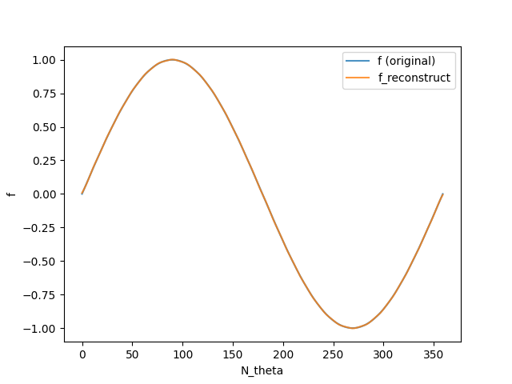
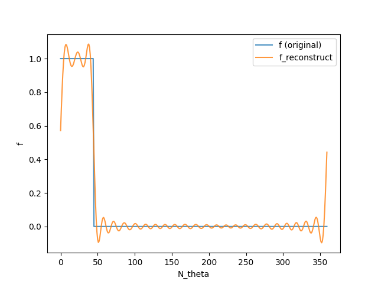
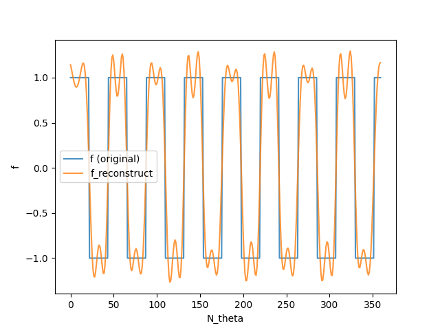
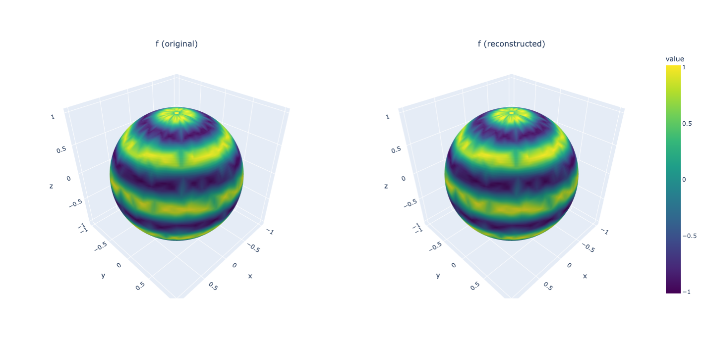
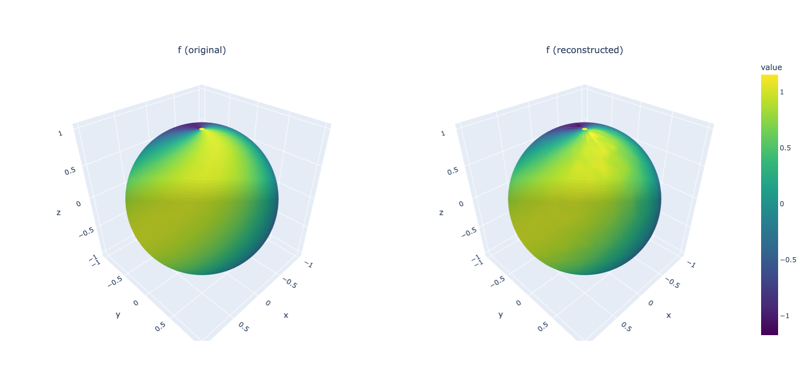
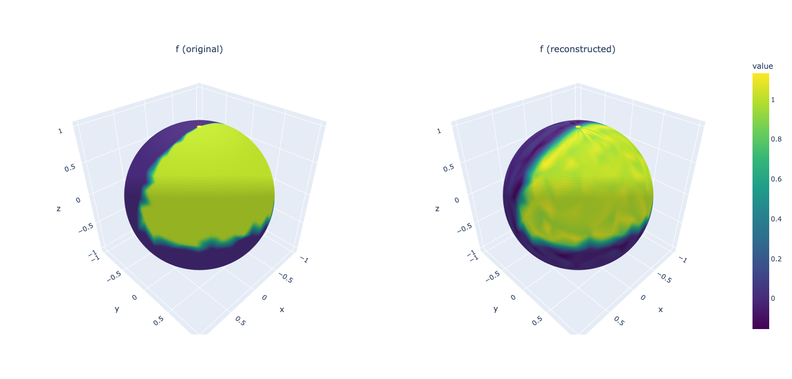
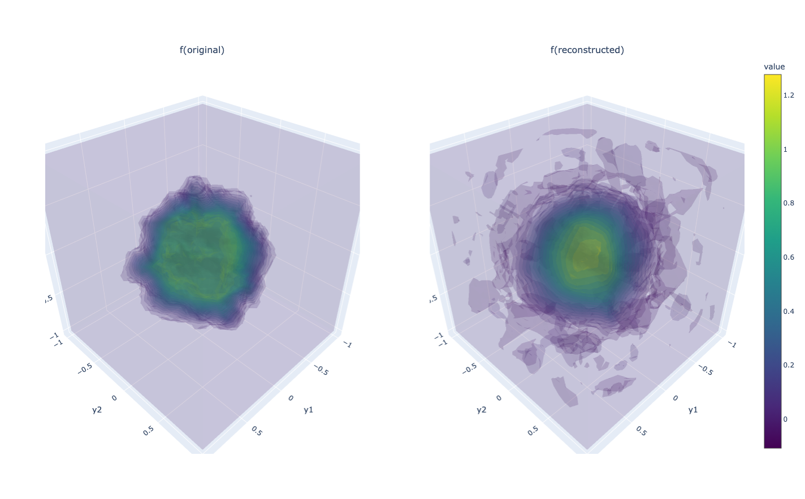
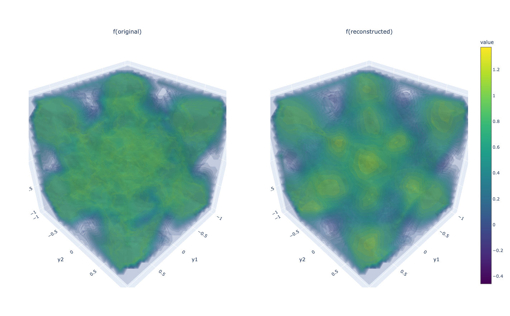

> [!NOTE] 
> For proper equation rendering, please view this documentation in day mode instead of night mode. 

# Author

An-Hsien KAO [](https://www.linkedin.com/in/an-hsien-kao-a63543342) , National Chengchi University, 116 Taipei, Taiwan. 

# Collaborators

[Pu-Zhao KOW](https://puzhaokow1993.github.io/homepage/index.html), National Chengchi University, 116 Taipei, Taiwan. 

[Yueh-Cheng KUO](https://sites.google.com/view/yckuo/home), National Chengchi University, 116 Taipei, Taiwan. 

# Introduction 

# functional-gkb
## Setup

```
pip install numpy matplotlib
```

## Quick start
```
python run.py <example> [--verbose] [--out NAME]
```

```
python run.py examples/Herglotz_n2.py             # n = 3 Herglotz operator
python run.py examples/Herglotz_n3.py             # n = 2 Herglotz operator
python run.py examples/multifreq_inverse_source.py    # multifrequency inverse source

python run.py examples/Herglotz_n2.py --verbose           # print solver progress
python run.py examples/Herglotz_n2.py --out my_run        # name the result folder
```

All settings are edited inside the example file. The command line only accepts `--verbose` and `--out`.

## Output

Every run creates a new folder `results/<example>_<timestamp>/` (or `results/<out>/`; an existing folder is never overwritten):

| File | Content |
|---|---|
| `solution.npz` | `U`, `S`, `V`. Rows of `U` / `V` are the left / right singular functions, evaluated at the sample points of `H2` / `H1` |
| `S.png` | singular values (semilog plot) |
| `params.json` | the `PARAMS` and `SOLVER` actually used, and the example path |

### Reload the results
```python
import numpy as np
d = np.load("results/<run>/solution.npz")
U, S, V = d["U"], d["S"], d["V"]
```

## Examples

| File | Operator |
|---|---|
| `examples/Herglotz_n2.py` | Herglotz wave function (n=2): $L^2(\mathbb{S}^1) \to L^2(B_1)$ |
| `examples/Herglotz_n3.py` | Herglotz wave function (n=3): $L^2(\mathbb{S}^2) \to L^2(B_1)$  |
| `examples/multifreq_inverse_source.py` | $G_{\mathbf{k}}: L^2(B_1)\to L^2((0,\mathbf{k})\times\mathbb{S}^{n-1})$ |

## Adding an operator

Create a new file that defines:

```python
PARAMS = dict(...)   # problem parameters, passed to build(**PARAMS)
SOLVER = dict(...)   # solver parameters (table below)

def build(**params):
    ...
    return dict(
        T=...,          # f in H1 -> T f in H2
        T_adj=...,      # g in H2 -> T* g in H1  (adjoint w.r.t. the two inner products)
        inner_dom=...,  # inner product of H1 (conjugate-linear in the first argument)
        inner_cod=...,  # inner product of H2
        f0=...,         # starting function in H1
    )
```

`PARAMS` and `SOLVER` are optional. Norms are derived from the inner products, so they are not passed separately. **Nothing in `fgkb/` needs to change.** Since the solver only sees these five objects, the sampling scheme and quadrature weights are entirely up to the example. `fgkb/sampling.py` has the Halton point generators used by the current examples.


## Solver parameters (`SOLVER`)

Defined by `golub_kahan_thick_restart` in `fgkb/gkb.py`.

| Parameter | Meaning |
|---|---|
| `K` | maximum Lanczos steps per restart cycle (Krylov subspace size) |
| `n_threshold` | stop once this many singular triplets have converged |
| `restart_threshold` | if more than `K * restart_threshold` this many converge in one cycle, lock them and deflate |
| `max_restarts` | maximum restarts per deflation level |
| `res_tol` | residual tolerance for declaring a Ritz triplet converged |
| `tau_tol` | tolerance for loss of orthogonality; the cycle stops when exceeded |

## Algorithm notes

- Thick-restart: after each cycle the best `l` Ritz triplets are kept and the bidiagonalization is continued from them.
- Deflation: converged left singular functions are projected out of the range of `T` (one-sided), and the iteration restarts for the next batch.
- Reorthogonalization is one-sided (right vectors only); orthogonality of both bases is monitored with `check_orthogonality` under the respective inner products.

## Layout

```
functional-gkb/
├── fgkb/
│   ├── gkb.py          # GKB, thick restart, deflation
│   └── sampling.py     # Halton point generators
├── examples/           # one operator per file
├── run.py              # python run.py <example> [--verbose] [--out NAME]
└── README.md
```

# Results 

## Recovering the density of Herglotz wave function. 
We consider the normalized Herglotz wave function restricted to the unit ball from [arXiv:2404.18482](https://arxiv.org/abs/2404.18482): 

$$A_\kappa : L^2(\mathbb{S}^{n-1}) \to L^2(B_1), \quad A_\kappa(f) := \kappa^{\frac{n-1}{2}} \int_{\mathbb{S}^{n-1}} e^{i\kappa\omega \cdot x} f(\omega) \, \mathrm{d} S(\omega). $$

We successfully reconstructed test functions with the following formula with $\tilde\sigma_j>0.1$:
$$\tilde{f}_{N} = \sum_{j=1}^{N}\frac{1}{\tilde{\sigma}_{j}}(\mathsf{m},\tilde{\mathfrak{g}}_{j})_{Y}\tilde{\mathfrak{e}}_{j}$$

### Case 1: $n=2~(\kappa=20)$ 

| Test function | $R^2$ | plot|
| -------- | -------- | -------- |
| Sine wave    | 0.999997 |  |
| Indicator    | 0.963859 | |
| Square wave  | 0.900786 |  |

see: `examples/Herglotz_n2.py`

### Case 2: $n=3~(\kappa=10)$ 

| Test function | $R^2$ | plot|
| -------- | -------- | -------- |
| Highly oscillatory function | 0.983435|  |
| Low oscillatory function | 0.976296 |  |
| Indicator | 0.937080 |  |

see: `examples/Herglotz_n3.py`

## Multifrequency inverse source problem

We consider the multifrequency far-field operator with maximal wave number $\mathbf{k}$ from [arXiv:2401.13279](https://arxiv.org/abs/2401.13279):

$$(G_{\mathbf{k}}f)(\kappa,\hat x) = \chi_{(0,\mathbf{k})}(\kappa) u_{\kappa}^{\infty}[f](\hat{x}) = \chi_{(0,\mathbf{k})}(\kappa) \mathscr{F}(f\chi_{B_{1}})(\kappa\hat{x})$$

Similarly, We reconstruct test functions with the following formula with $\tilde\sigma_j>0.1$:
$$\tilde{f}_{N} = \sum_{j=1}^{N}\frac{1}{\tilde{\sigma}_{j}}(\mathsf{m},\tilde{\mathfrak{g}}_{j})_{Y}\tilde{\mathfrak{e}}_{j}$$

| Test function | $R^2$ | plot|
| -------- | -------- | -------- |
| Checkerboard function | 0.669669 |  |
| Indicator function | 0.852695 |  |

see: `examples/multifreq_inverse_source.py`